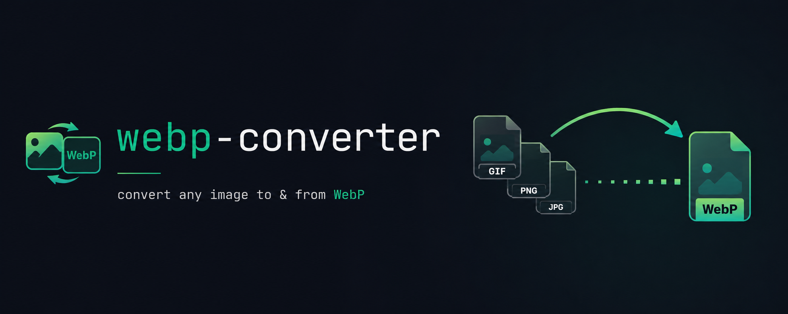

<p align="center">
  <a href="https://www.npmjs.com/package/webp-converter">
    
  </a>
</p>

# webp-converter

A small [Node.js](http://nodejs.org) library for converting images to/from the
WebP format. It is a thin, typed wrapper around the official precompiled
[libwebp](https://developers.google.com/speed/webp) command-line tools
(`cwebp`, `dwebp`, `gif2webp`, `webpmux`), which ship bundled with the package —
no system install or download step required.

- **Zero runtime dependencies**
- **TypeScript types** included
- **ESM and CommonJS** both supported
- Node.js **>= 18**

📖 **[Full usage guide](docs/USAGE.md)** · 🧪 **[Runnable examples](examples/)**

Reference docs for the underlying tools:
[cwebp](https://developers.google.com/speed/webp/docs/cwebp) ·
[dwebp](https://developers.google.com/speed/webp/docs/dwebp) ·
[gif2webp](https://developers.google.com/speed/webp/docs/gif2webp) ·
[webpmux](https://developers.google.com/speed/webp/docs/webpmux)

## Installation

```bash
npm install webp-converter
```

## Importing

```js
// ESM / TypeScript
import webp from 'webp-converter';
// or named: import { cwebp, dwebp } from 'webp-converter';

// CommonJS
const webp = require('webp-converter');
```

Every conversion function returns a **Promise**. On Linux/macOS, call
`grant_permission()` once first so the bundled binaries are executable:

```js
webp.grant_permission();
```

> **Errors reject.** As of 3.0, a failed conversion **rejects** the Promise
> (2.x resolved instead). Use `try/catch` with `await`, or `.catch()`.

> **Security.** File paths are passed to the binaries verbatim (no shell), so
> user-supplied filenames are safe. The `option` argument, however, is split
> into individual CLI flags — **do not pass untrusted input as `option`**, or a
> caller could inject extra flags (e.g. a second `-o` to redirect output). Treat
> `option` as trusted, developer-controlled configuration.

## cwebp — convert any image to WebP

```js
try {
  const response = await webp.cwebp('nodejs_logo.jpg', 'nodejs_logo.webp', '-q 80');
  console.log(response);
} catch (err) {
  console.error('conversion failed', err);
}
```

Pass `'-v'` as the optional 4th `logging` argument for verbose libwebp output
(defaults to `'-quiet'`).

## dwebp — convert WebP to another format

```js
await webp.dwebp('nodejs_logo.webp', 'nodejs_logo.jpg', '-o');
```

## gwebp — convert a GIF to WebP

```js
await webp.gwebp('linux_logo.gif', 'linux_logo.webp', '-q 80');
```

## Buffers and base64

```js
import { readFile } from 'node:fs/promises';

// image buffer -> webp buffer
const webpBuffer = await webp.buffer2webpbuffer(await readFile('nodejs_logo.jpg'), 'jpg', '-q 80');

// base64 image string -> base64 webp string
const base64 = (await readFile('nodejs_logo.jpg')).toString('base64');
const webpBase64 = await webp.str2webpstr(base64, 'jpg', '-q 80');
```

Both accept an optional final `extra_path` argument to use your own directory
for intermediate files (otherwise a folder under `os.tmpdir()` is created
automatically). Temp files are cleaned up after each call.

## webpmux — metadata and animation

> `webpmux` has no logging flag; the trailing `logging` argument on these
> functions is accepted for compatibility but ignored.

```js
// Add / extract / strip ICC ('icc'), XMP ('xmp') or EXIF ('exif')
await webp.webpmux_add('in.webp', 'icc_container.webp', 'image_profile.icc', 'icc');
await webp.webpmux_extract('anim_container.webp', 'image_profile.icc', 'icc');
await webp.webpmux_strip('icc_container.webp', 'without_icc.webp', 'icc');

// Build an animated WebP from frames
const frames = [
  { path: './frames/tmp-0.webp', offset: '+100' },
  { path: './frames/tmp-1.webp', offset: '+100' },
  { path: './frames/tmp-2.webp', offset: '+100' },
];
await webp.webpmux_animate(frames, 'anim_container.webp', '10', '255,255,255,255');

// Extract a single frame
await webp.webpmux_getframe('anim_container.webp', 'frame_2.webp', '2');
```

Frame `offset` follows the webpmux `FRAME_OPTIONS` syntax
(`+di[+xi+yi[+mi[bi]]]`); `loop` of `0` loops forever; `bgcolor` is `A,R,G,B`.
See the [webpmux docs](https://developers.google.com/speed/webp/docs/webpmux)
for details.

## Using your own / newer binaries

By default the library uses the libwebp binaries bundled under `bin/`. To point
it at a different set — a newer libwebp release, or a platform not bundled (e.g.
linux-arm64) — give it a directory containing the tools directly (`cwebp`,
`dwebp`, `gif2webp`, `webpmux`; add `.exe` on Windows):

```js
import webp from 'webp-converter';

webp.setBinaryDir('/opt/libwebp-1.7.0/bin'); // pass undefined to reset to bundled
```

Or set it without touching code via an environment variable:

```bash
WEBP_CONVERTER_BIN_DIR=/opt/libwebp-1.7.0/bin node app.js
```

Resolution order is: `setBinaryDir()` → `WEBP_CONVERTER_BIN_DIR` → bundled
binary for the current platform. A directory set this way also works on
platforms the package does not bundle binaries for.

## Documentation & examples

- **[docs/USAGE.md](docs/USAGE.md)** — full API reference, temp-file handling,
  security notes, and troubleshooting.
- **[examples/](examples/)** — runnable scripts for every feature:

  ```bash
  npm install && npm run build
  node examples/01-image-to-webp.mjs
  ```

  | Example                     | Shows                                    |
  | --------------------------- | ---------------------------------------- |
  | `01-image-to-webp.mjs`      | `cwebp` — image → WebP                   |
  | `02-webp-to-image.mjs`      | `dwebp` — WebP → image                   |
  | `03-gif-to-webp.mjs`        | `gwebp` — GIF → WebP                     |
  | `04-buffers-and-base64.mjs` | in-memory buffer / base64 conversion     |
  | `05-metadata.mjs`           | `webpmux` ICC/XMP/EXIF add·extract·strip |
  | `06-animation.mjs`          | build & read animated WebP               |
  | `07-custom-binaries.mjs`    | `setBinaryDir` / env var                 |
  | `commonjs.cjs`              | CommonJS `require` usage                 |

## Migrating from 2.x

The function names and argument order are unchanged. Review these behavior
changes (full list in [CHANGELOG.md](CHANGELOG.md)):

- Failed conversions now **reject** — add error handling.
- Node **>= 18** is required.
- `webpmux_*` calls that relied on the default `logging` now actually succeed
  (they silently failed in 2.x).

## License

[MIT](LICENSE)
